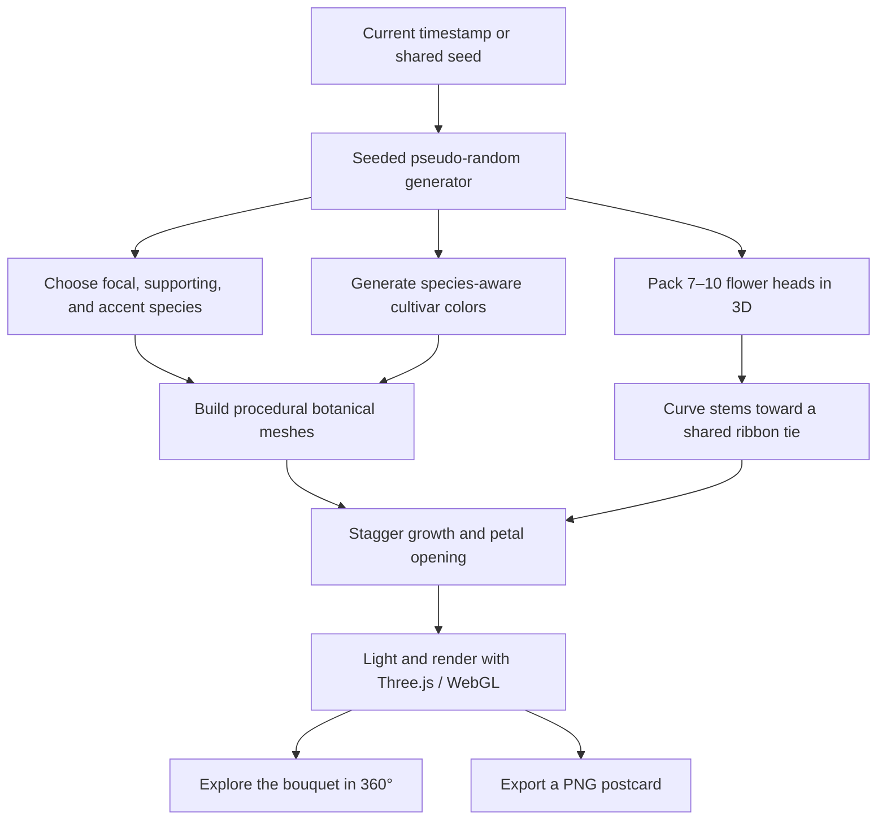

<p align="center">
  
</p>

<h1 align="center">Flowers for You</h1>

<p align="center"><em>Give flowers to someone you love.</em></p>

<p align="center">
  Grow a surprise 3D bouquet, find one that feels right, and send it to someone you love.<br />
  They open a personal cover, watch your bouquet bloom, and can keep it as a PNG postcard.
</p>

<p align="center">
  <a href="https://mesterm12.github.io/moment-garden/">Open the garden</a> ·
  <a href="#the-garden">Preview</a> ·
  <a href="#run-it-locally">Run locally</a> ·
  <a href="#how-it-grows">How it works</a> ·
  <a href="#development">Development</a>
</p>

<p align="center">
  
  
  
  <a href="LICENSE"></a>
</p>

## The garden

The garden gathers **7–10 stems from at least three flower types**, brings them into bloom, and ties them into a little bouquet. Open the garden for a surprise or follow a shared link to receive someone’s chosen bouquet. Tap **Open your flowers** to lift the cover and begin the bloom. All geometry is generated in code—not loaded from photographs or model files.

<p align="center">
  
</p>

### Made to be explored

- **Always a surprise.** Five bouquet silhouettes, seven color families, and three ties: bow, twine, or wrap. The timestamp chooses the combination; there are no flower or color selectors.
- **15 botanical recipes.** Roses, tulips, dahlias, sunflowers, daisies, lilies, poppies, cosmos, ranunculus, calla lilies, orchids, irises, hydrangeas, anemones, and billy buttons.
- **Different construction, not just recoloring.** Nested rose cups, rolled dahlia florets, trumpet-shaped calla lilies, ruffled irises, and hydrangea clusters.
- **A full blooming sequence.** Staggered growth, unfolding leaves, and opening petals. The bouquet rests once it has bloomed.
- **Unrestricted 360° rotation.** Explore above, below, and behind the bouquet with a mouse, touch, or keyboard.
- **A gift to open.** Send a link that holds your exact bouquet behind a personal cover. Opening it begins the bloom from the front; keyboard opening and reduced-motion preferences show the finished arrangement immediately.
- **A keepsake.** Download the current bouquet view as a PNG postcard.
- **A quieter experience.** Reduced-motion preferences show the completed bouquet without the growth animation. Keyboard-activated opening, replay, and generation also show the finished arrangement immediately.

### One garden, many bouquets

Five silhouettes give the stems a different shape even before color and flower choice come into play.

<p align="center">
  
</p>

These four studies show some of the original flowers, which are still in the mix.

<p align="center">
  
</p>

### Desktop & mobile

<table>
  <tr>
    <td width="72%" valign="top"></td>
    <td width="28%" valign="top"></td>
  </tr>
</table>

## Run it locally

**No install, bundler, or build step is required.** Open [`index.html`](index.html) in a modern browser with WebGL enabled.

Or serve the directory over HTTP:

```sh
git clone https://github.com/mesterM12/moment-garden.git
cd moment-garden
python3 -m http.server 8000
```

Visit **http://localhost:8000**. Stop the server with `Ctrl+C`.

Three.js is vendored locally, so rendering does not depend on a JavaScript CDN. Google Fonts are optional network requests; system fonts are used if they are unavailable.

### Controls

| Action | Control |
| --- | --- |
| Open the gift | **Open your flowers** (tap, click, or keyboard activation) |
| Rotate in any direction | Drag the bouquet with a mouse or one finger |
| Rotate with the keyboard | Focus the bouquet with `Tab`, then use the arrow keys |
| Return to the front | **Reset view**, or `Home` while the bouquet is focused |
| Generate a new bouquet | **Grow another** |
| Replay the same bouquet | **Replay bloom** |
| Send the current bouquet | **Send flowers** |
| Save a PNG postcard | Download icon at the bottom-right of the card |

**Send flowers** opens the system share sheet when available. Otherwise it copies the link or shows it for manual copying. Link sharing requires an HTTP(S) page; use the public garden to send links that others can open. When opened as a local file, the garden can still save a PNG.

Touch gestures inside the bouquet rotate it; scroll the page from outside the illustration. Saving completes the bloom and captures the current viewing angle.

## How it grows



### A shared seed, independent details

`botany.js` turns a millisecond timestamp into a bouquet plan. Each stem gets a derived seed for its geometry, while repeated species share cultivar colors. Layout is chosen before tessellation. Flower-head envelopes keep the mature blooms apart in 3D. Stem paths make room around neighboring heads, and crowded leaves are shortened, redirected, or omitted.

Replay, rotation, and PNG export keep the existing bouquet. **Grow another** starts from a new timestamp and clears any bouquet seed from the address, so refreshing afterward is a fresh visit. The link carries the arrangement, not the sender’s camera angle. Browser/GPU rendering can vary. Messaging apps show a general preview image; the link itself opens the exact bouquet.

#### Bouquet link contract

**Send flowers** adds a token like `?bouquet=1970260fcfb` to the site path. The token is the bouquet’s timestamp in lowercase hexadecimal, with no leading zeros (except `0`). It represents a nonnegative Unix timestamp in milliseconds within the JavaScript `Date` range. An invalid link shows a notice and grows a fresh bouquet.

### Geometry with botanical cues

| Flower | Procedural construction |
| --- | --- |
| Rose | Nested angular-sector petals with overlapping lips and a closed center |
| Tulip | Two interleaved whorls of three curved shells forming an upright cup |
| Dahlia | 140 rolled florets arranged with golden-angle spacing over a rounded backing |
| Sunflower | Narrow ray petals surrounding a dark, densely sampled seed disk |
| Daisy | Slender ray petals surrounding a gold floret center |
| Poppy | Broad, ruffled petals around a capsule and dark stamens |
| Lily | Six recurved tepals, dark flecks, elongated anthers, and a central style |
| Cosmos | Eight broad rays with shallow tip notches and a golden center |
| Ranunculus | Tightly layered, rounded petals |
| Calla lily | A curled spathe wrapped around a spadix |
| Orchid | Broad petals and a distinct labellum |
| Iris | Upright standards and outward falls |
| Hydrangea | A rounded cluster of four-lobed florets |
| Anemone | Broad petals and a dark central boss |
| Billy button | A sphere of tiny golden florets |

These are stylized procedural interpretations, not botanical simulations or photorealistic scanned models. Lighting, petal gradients, surface veins, and constrained pigment ranges help the species remain recognizable at postcard scale. Design observations and remaining refinement ideas are recorded in [`DESIGN-REVIEW.md`](DESIGN-REVIEW.md).

## Development

The site is plain HTML, CSS, and JavaScript. **Node.js 18+** is only needed to run the tests.

```sh
node --test *.test.cjs
node --check botany.js
node --check botany-varieties.js
node --check extra-blooms.js
node --check bouquet-link.js
node --check flower.js
node --check petal-meshes.js
```

The tests cover deterministic generation, species meshes and bloom shapes, bouquet diversity, mature head clearance, the bouquet link contract, and the opening cover’s focus and inert-state lifecycle. For a browser check, share a bouquet from the HTTP-served site, open the link in a private window, and confirm that the same bouquet blooms. Try **Grow another** and refresh to check that the old bouquet doesn’t return.

### Project map

```text
moment-garden/
├── index.html             # Postcard markup and controls
├── style.css              # Paper, typography, layout, responsive styles
├── botanical.css          # Illustration and interaction styles
├── botany.js              # Seeded bouquet planning
├── botany-varieties.js    # Recipes and pigment ranges for additional varieties
├── bouquet-link.js        # Bouquet URL encoding and decoding
├── petal-meshes.js        # Dedicated rose, tulip, and dahlia surfaces
├── extra-blooms.js        # Additional flower geometries
├── flower.js              # Scene, animation, input, sharing, and export
├── botany.test.cjs        # Seeded generation tests
├── bouquet-link.test.cjs  # Share URL contract tests
├── extra-blooms.test.cjs  # Geometry and morph-target tests
├── DESIGN-REVIEW.md       # Botanical geometry review and refinement notes
├── docs/images/           # Logo, screenshots, gallery, and animated preview
└── vendor/                # Three.js 0.160.1 and its license
```

### Hosting

Deploy the folder to any static host. There is no backend, build command, database, API key, or runtime configuration. For GitHub Pages, select **Deploy from a branch → main → / (root)** in the repository's Pages settings.

### Contributing

Small botanical improvements are welcome. Keep the experience surprise-only, preserve seeded reproducibility, and check both desktop and mobile. When changing a mesh, include before/after renders and inspect it from the front, a quarter turn, and behind. Please run the generator tests before opening a pull request.

## Credits & license

- Rendering: [Three.js](https://threejs.org/), MIT; its license is retained in [`vendor/THREE-LICENSE.txt`](vendor/THREE-LICENSE.txt).
- Typography: Instrument Serif, DM Sans, and IBM Plex Mono, optionally loaded from Google Fonts.
- All bouquet geometry and screenshot examples are generated by this project.

Project code, documentation, logo, and screenshots are available under the [MIT License](LICENSE).

<p align="center"><em>Grown from time. A little different, every second.</em></p>
