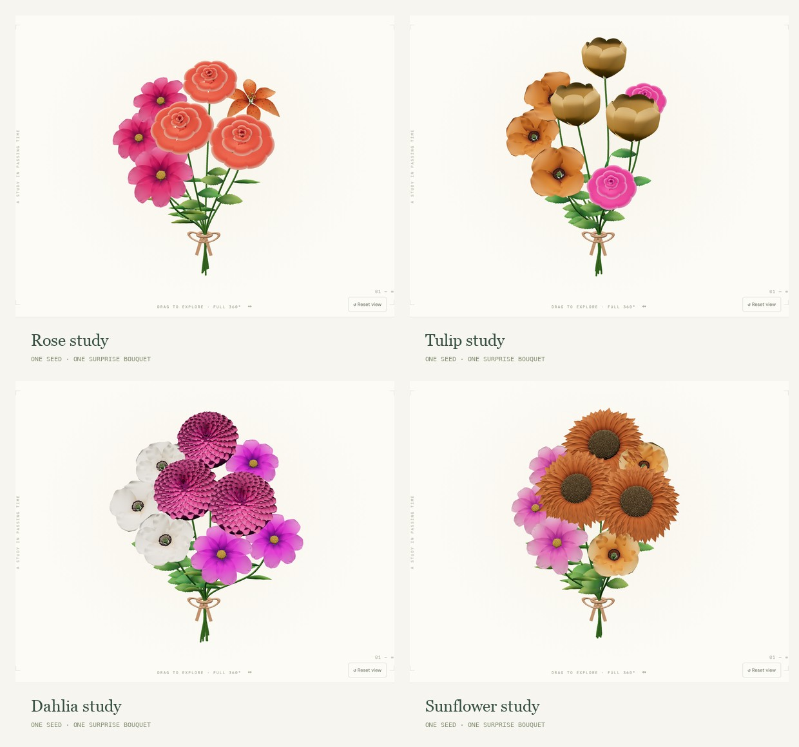
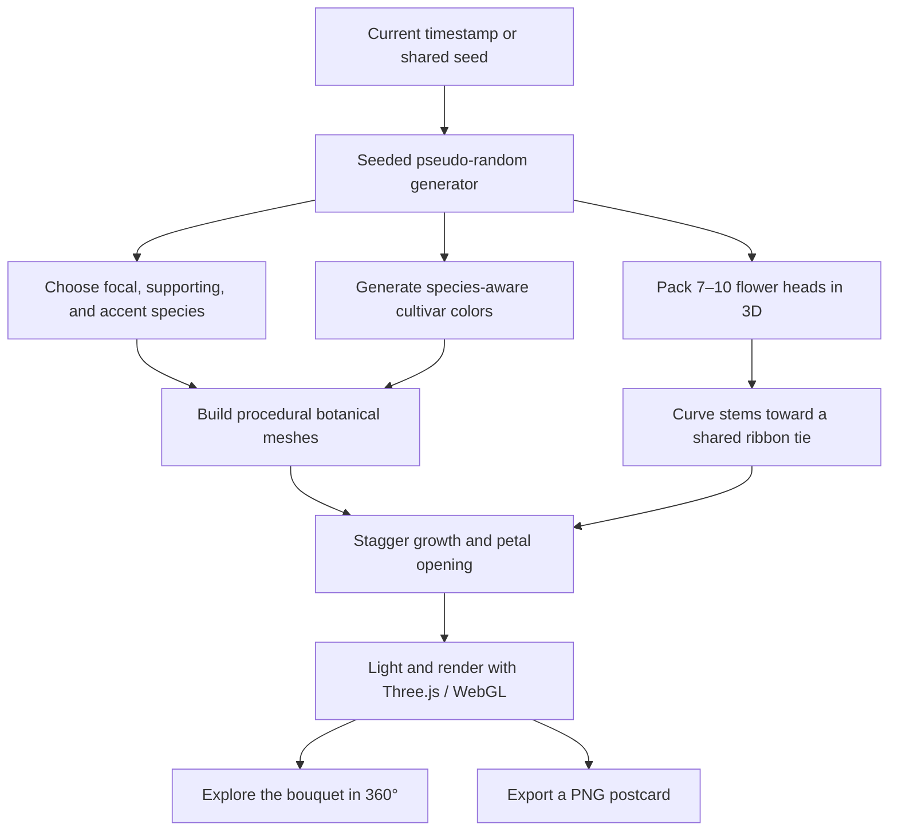

<p align="center">
  
</p>

<h1 align="center">Flowers for You</h1>

<p align="center"><em>Give flowers to someone you love.</em></p>

<p align="center">
  Grow a surprise 3D bouquet, find one that feels right, and send it to someone you love.<br />
  They tap to open the cover, watch your bouquet bloom, and can keep it as a PNG postcard.
</p>

<p align="center">
  <a href="https://mesterm12.github.io/moment-garden/">Open the garden</a> ·
  <a href="#the-garden">Preview</a> ·
  <a href="#run-it-locally">Run locally</a> ·
  <a href="#how-it-grows">How it works</a> ·
  <a href="#development">Development</a> ·
  <a href="docs/DEPLOYMENT.md">Deployment</a>
</p>

<p align="center">
  
  
  
  <a href="LICENSE"></a>
</p>

## The garden

The garden gathers **7–10 stems from at least three flower types**, brings them into bloom, and ties them into a little bouquet. Open the garden for a surprise or follow a shared link to receive someone’s chosen bouquet. Tap **Open your flowers** to lift the cover and begin the bloom. All geometry is generated in code—not loaded from photographs or model files.

<p align="center">
  
</p>

### Made to be explored

- **Always a surprise.** Five bouquet silhouettes, seven color families, and three ties: bow, twine, or wrap. The timestamp chooses the combination; there are no flower or color selectors.
- **15 botanical recipes.** Roses, tulips, dahlias, sunflowers, daisies, lilies, poppies, cosmos, ranunculus, calla lilies, orchids, irises, hydrangeas, anemones, and billy buttons.
- **Different construction, not just recoloring.** Nested rose cups, rolled dahlia florets, trumpet-shaped calla lilies, ruffled irises, and hydrangea clusters.
- **A 4.6-second bloom.** Stems grow, leaves unfold, and petals open in sequence. The bouquet has no idle sway.
- **Unrestricted 360° rotation.** Explore above, below, and behind the bouquet. Dragging follows your pointer directly; a flick settles into a new angle. Arrow keys turn the bouquet in steps.
- **A gift to open.** Send a link that holds your exact bouquet behind a sealed cover. Tapping or clicking the opener starts the bloom from the front.
- **A keepsake.** Download the finished bouquet at its current angle as a PNG postcard.
- **A quieter experience.** Opening or growing a bouquet by keyboard shows the finished arrangement immediately. Reduced motion also skips the bloom and rotation momentum without disabling drag or keyboard rotation. **Replay bloom** is available only when motion is allowed.

### One garden, many bouquets

Five silhouettes give the stems a different shape even before color and flower choice come into play.

<p align="center">
  
</p>

These four studies show some of the original flowers, which are still in the mix.

<p align="center">
  
</p>

### A gift to open

<p align="center">
  
</p>

### Desktop & mobile

Current React postcard, shown with [the same reproducible bouquet](https://mesterm12.github.io/moment-garden/?bouquet=1970260fcfb) on desktop and mobile. Screenshots capture the finished bouquet; the bloom plays when opened by pointer with motion enabled.

<table>
  <tr>
    <td width="72%" valign="top"></td>
    <td width="28%" valign="top"></td>
  </tr>
</table>

## Run it locally

Use **Node.js 24** (the version used in CI), npm, and a modern browser with WebGL enabled. Vite 8 itself requires Node.js 20.19+ in the 20.x line or 22.12+, but some test dependencies require a newer release.

```sh
git clone https://github.com/mesterM12/moment-garden.git
cd moment-garden
npm ci
npm run dev
```

Open the URL Vite prints, usually **http://127.0.0.1:5173**. Stop the server with `Ctrl+C`. Opening [`index.html`](index.html) directly from disk is not supported.

The build bundles Three.js from npm; rendering does not depend on a JavaScript CDN. Google Fonts are optional; system fonts are used if they are unavailable.

### Controls

| Action | Control |
| --- | --- |
| Open the gift | **Open your flowers** (tap, click, or keyboard activation) |
| Rotate in any direction | Drag the bouquet with a mouse or one finger |
| Rotate with the keyboard | Focus the bouquet with `Tab`, then use the arrow keys |
| Return to the front | Click or tap **Reset view** for a spring turn along the shortest route, or press `Home` on the focused bouquet to reset instantly |
| Generate a new bouquet | **Grow another** |
| Replay the same bouquet | **Replay bloom** |
| Send the current bouquet | **Send flowers** |
| Save a PNG postcard | **Save postcard** (or **Save** on narrow screens) at the bottom of the card |

**Send flowers** uses the system share sheet when available. Otherwise it tries to copy the link to the clipboard and offers the link for manual copying if needed. Use a public HTTPS deployment to send links others can open. Feedback confirms a copied link or a PNG ready to save, not that a gift was delivered.

Touch gestures inside the bouquet rotate it; scroll the page from outside the illustration. Saving completes the bloom and captures the current viewing angle.

## How it grows



### A shared seed, independent details

[`src/garden/botany.js`](src/garden/botany.js) turns a millisecond timestamp into a bouquet plan. Each stem gets a derived seed for its geometry, while repeated species share cultivar colors. Layout is chosen before tessellation. Flower-head envelopes keep the mature blooms apart in 3D. Stem paths make room around neighboring heads, and crowded leaves are shortened, redirected, or omitted.

Replay, rotation, and PNG export keep the existing bouquet. **Grow another** starts from a new timestamp and clears any bouquet seed from the address, so refreshing afterward is a fresh visit. The link carries the arrangement, not the sender’s camera angle. Browser/GPU rendering can vary. Messaging apps show a general preview image; the link itself opens the exact bouquet.

#### Bouquet link contract

**Send flowers** adds a token like `?bouquet=1970260fcfb` to the site path. The token is the bouquet’s timestamp in lowercase hexadecimal, with no leading zeros (except `0`). It represents a nonnegative Unix timestamp in milliseconds within the JavaScript `Date` range. Existing links use the same format and still restore the same bouquet. An invalid link shows a notice and grows a fresh bouquet. All bouquet generation and interaction state stay in the browser; there is no server-side lookup.

### Geometry with botanical cues

| Flower | Procedural construction |
| --- | --- |
| Rose | Nested angular-sector petals with overlapping lips and a closed center |
| Tulip | Two interleaved whorls of three curved shells forming an upright cup |
| Dahlia | 140 rolled florets arranged with golden-angle spacing over a rounded backing |
| Sunflower | Narrow ray petals surrounding a dark, densely sampled seed disk |
| Daisy | Slender ray petals surrounding a gold floret center |
| Poppy | Broad, ruffled petals around a capsule and dark stamens |
| Lily | Six recurved tepals, dark flecks, elongated anthers, and a central style |
| Cosmos | Eight broad rays with shallow tip notches and a golden center |
| Ranunculus | Tightly layered, rounded petals |
| Calla lily | A curled spathe wrapped around a spadix |
| Orchid | Broad petals and a distinct labellum |
| Iris | Upright standards and outward falls |
| Hydrangea | A rounded cluster of four-lobed florets |
| Anemone | Broad petals and a dark central boss |
| Billy button | A sphere of tiny golden florets |

These are stylized procedural interpretations, not botanical simulations or photorealistic scanned models. Lighting, petal gradients, surface veins, and constrained pigment ranges help the species remain recognizable at postcard scale. Design observations and remaining refinement ideas are recorded in [`DESIGN-REVIEW.md`](DESIGN-REVIEW.md).

## Development

The browser app uses React 19.3 and TypeScript, built with Vite 8 and Tailwind CSS 4. The ui-sdk React 0.1 beta handles interaction behavior, including pending states for async actions; local shadcn buttons provide presentation, with Lucide icons. Three.js 0.160.1 renders the procedural geometry in WebGL.

React owns the renderer lifecycle, including disposal of the renderer, textures, listeners, and observers on unmount and during development Strict Mode remounts. Per-frame geometry and rotation stay outside React state. Dragging updates rotation 1:1 at the configured sensitivity. Release projects the drag velocity into a spring target (0.4 s response, 0.8 damping ratio); pointer reset springs to the nearest equivalent front angle (0.4 s response, 1.0 damping ratio). Keyboard and reduced-motion controls do not add momentum.

After `npm ci`:

```sh
npm test                         # Node and React tests
npm run build                    # Type-check and build dist/
npm run preview                  # Serve dist/ locally for a smoke check
```

Open the preview URL Vite prints, usually **http://127.0.0.1:4173**. Open a shared URL such as `/?bouquet=1970260fcfb` in a private window and verify it restores the same bouquet. Try **Grow another** and refresh: the old seed should not return.

To run the desktop and mobile Playwright checks against the built site, build first, then run:

```sh
npx playwright install chromium
npm run test:e2e                 # Starts its own preview server on port 4175
```

### Project map

- [`index.html`](index.html) and [`src/main.tsx`](src/main.tsx): Vite entry page and React entry point.
- [`src/App.tsx`](src/App.tsx) and [`src/components/`](src/components/): gift state, focus handoff, reveal, and sharing/saving feedback.
- [`src/garden/engine.ts`](src/garden/engine.ts) and [`src/garden/rotation.ts`](src/garden/rotation.ts): disposable Three.js rendering and frame-independent gesture physics.
- [`src/lib/bouquet-link.ts`](src/lib/bouquet-link.ts): the deterministic share-link contract.
- [`src/components/ui/`](src/components/ui/) and [`src/styles/`](src/styles/): local UI primitives and stationery styling.
- Root-level generators and their `.test.cjs` files: deterministic compatibility fixtures for bouquet plans, geometry, and links.
- [`tests/`](tests/): browser tests against the production build.
- [`DESIGN.md`](DESIGN.md) and [`PRODUCT.md`](PRODUCT.md): the current visual system and product constraints.
- [`docs/DEPLOYMENT.md`](docs/DEPLOYMENT.md): publishing, verification, troubleshooting, and rollback.
- [`docs/images/`](docs/images/) and [`DESIGN-REVIEW.md`](DESIGN-REVIEW.md): current screenshots, earlier flower studies, and historical botanical geometry notes.

### Hosting

Run `npm ci` and `npm run build`, then publish the contents of **`dist/`**, not the repository root. The result is a static site: no Next.js or Node.js runtime server, backend, database, API keys, or runtime settings are required.

Vite’s relative asset base (`./`) lets the same build run at a domain root or a subpath such as `/moment-garden/`. The included [Pages workflow](.github/workflows/pages.yml) tests and builds the site, uploads `dist/`, and deploys that artifact on pushes to `main` or manual dispatch. Pages must use **GitHub Actions** as its source, not branch-root publishing. The separate test workflow also runs desktop/mobile browser checks but does not publish.

See [Deployment](docs/DEPLOYMENT.md) for setup, release verification, and rollback. Keep the existing site path so previously shared bouquet links keep working. Local setup and `npm run build` do not deploy anything.

### Contributing

Small botanical improvements are welcome. Keep the experience surprise-only, preserve seeded reproducibility, and check both desktop and mobile. When changing a mesh, include before/after renders and inspect it from the front, a quarter turn, and behind. Please run the generator tests before opening a pull request.

## Credits & license

- Rendering: [Three.js](https://threejs.org/), MIT; its license is retained in [`vendor/THREE-LICENSE.txt`](vendor/THREE-LICENSE.txt).
- Typography: Instrument Serif and DM Sans, optionally loaded from Google Fonts.
- All bouquet geometry and screenshot examples are generated by this project.

Project code, documentation, logo, and screenshots are available under the [MIT License](LICENSE).

<p align="center"><em>Grown from time. A little different, every second.</em></p>
