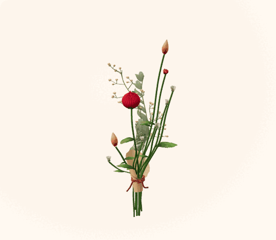
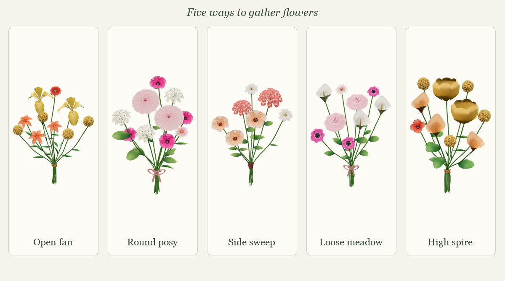
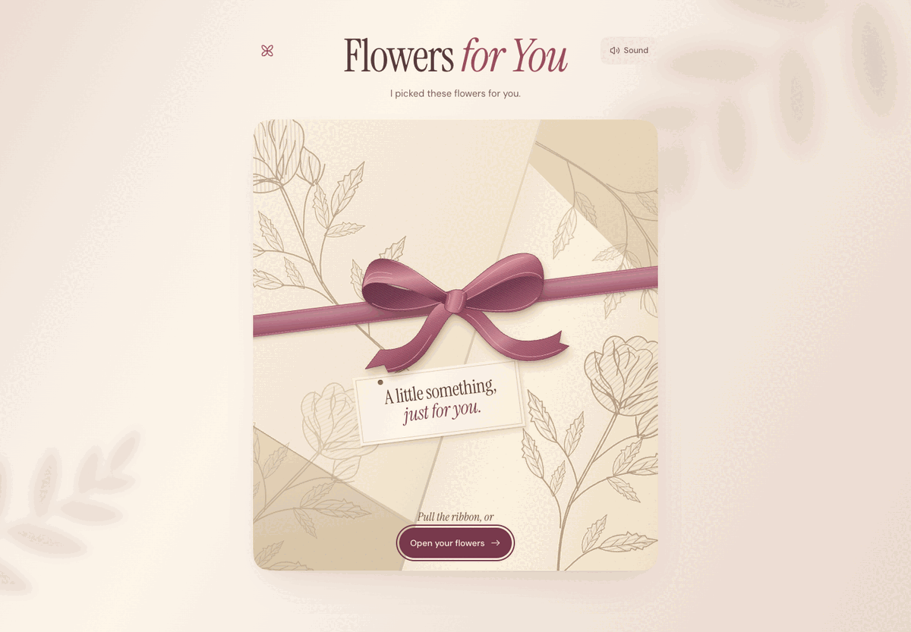
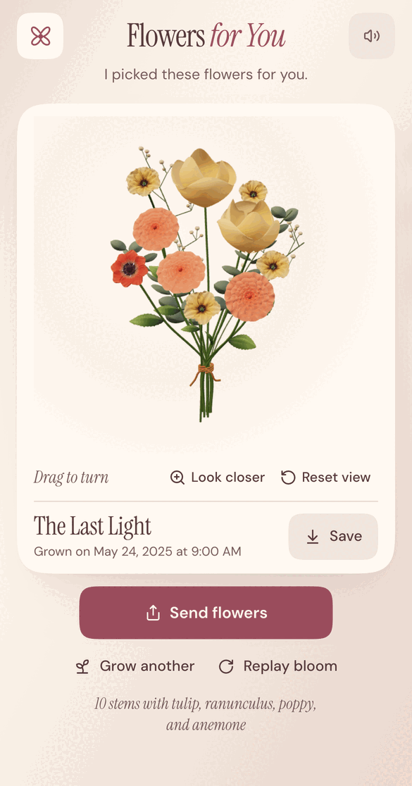
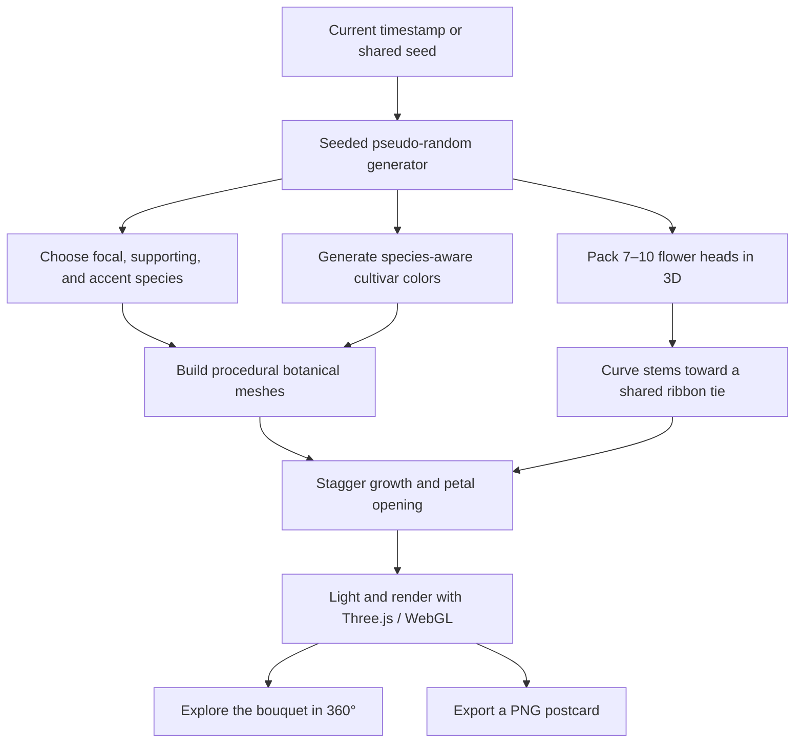

<p align="center">
  
</p>

<h1 align="center">Flowers for You</h1>

<p align="center"><em>Give flowers to someone you love.</em></p>

<p align="center">
  Grow a surprise 3D bouquet, find one that feels right, and send it to someone you love.<br />
  They tap to open the cover, watch your bouquet bloom, and can keep it as a PNG postcard.
</p>

<p align="center">
  <a href="https://flowers.joojoo-lab.xyz/">Live demo</a> ·
  <a href="#the-garden">Preview</a> ·
  <a href="#run-it-locally">Run locally</a> ·
  <a href="#how-it-grows">How it works</a> ·
  <a href="#development">Development</a> ·
  <a href="docs/DEPLOYMENT.md">Deployment</a>
</p>

<p align="center">
  
  
  
  <a href="LICENSE"></a>
</p>

Try the [live app](https://flowers.joojoo-lab.xyz/) or [open a reproducible bouquet](https://flowers.joojoo-lab.xyz/?bouquet=1970260fcfb). No account is required. The project is a self-hosted Next.js application with browser-side 3D rendering.

## The garden

The garden gathers **7–10 stems from at least three flower types**, brings them into bloom, and ties them into a little bouquet. Open the garden for a surprise or follow a shared link to receive someone’s chosen bouquet. Pull either silk tail and watch its loop slip through the knot. You can ease it back before letting go, or tap **Open your flowers** to watch the parcel untie itself. The printed tissue peels back while the buds begin to open. All geometry is generated in code—not loaded from photographs or model files.

<p align="center">
  
</p>

### Made to be explored

- **Always a surprise.** Five bouquet silhouettes, seven color families, and three ties: bow, twine, or wrap. The timestamp chooses the combination; there are no flower or color selectors.
- **15 botanical recipes.** Roses, tulips, dahlias, sunflowers, daisies, lilies, poppies, cosmos, ranunculus, calla lilies, orchids, irises, hydrangeas, anemones, and billy buttons.
- **Different construction, not just recoloring.** Nested rose cups, rolled dahlia florets, trumpet-shaped calla lilies, ruffled irises, and hydrangea clusters.
- **A 4.6-second bloom.** A leading stem opens first. Other flowers answer in overlapping waves: rose petals peel away, lily tips uncurl, and the rolled florets of a dahlia open from their edges. The arrangement settles to stillness. Use **Look closer** for a petal-level view.
- **Unrestricted 360° rotation.** Explore above, below, and behind the bouquet. Dragging follows your pointer directly; a flick settles into a new angle. Arrow keys turn the bouquet in steps.
- **A gift to open.** Send a link that holds your exact bouquet behind a sealed cover. Tapping or clicking the opener starts the bloom from the front.
- **A keepsake.** Download the finished bouquet at its current angle as a PNG postcard.
- **A quieter experience.** Opening or growing a bouquet by keyboard shows the finished arrangement immediately. Reduced motion also skips the bloom and rotation momentum without disabling drag or keyboard rotation. **Replay bloom** is available only when motion is allowed.
- **A garden to keep nearby.** Install the app from a supported browser, or use its Add to Home Screen option. After the first complete online load, the app shell and bouquet engine work offline—even for a shared bouquet URL you haven’t opened before.

### One garden, many bouquets

Five silhouettes give the stems a different shape even before color and flower choice come into play.

<p align="center">
  
</p>

These four studies show some of the original flowers, which are still in the mix.

<p align="center">
  
</p>

### A gift to open

<p align="center">
  
</p>

### Desktop & mobile

The postcard design, shown with the same reproducible bouquet (`?bouquet=1970260fcfb`) on desktop and mobile. Screenshots capture the finished bouquet; the bloom plays when opened by pointer with motion enabled.

<table>
  <tr>
    <td width="72%" valign="top"></td>
    <td width="28%" valign="top"></td>
  </tr>
</table>

## Run it locally

Use **Node.js 24 or newer**, npm, and a modern browser with WebGL enabled. The app uses the Next.js 16 App Router; Vite is a development dependency for Vitest, not the application server or bundler.

```sh
git clone https://github.com/mesterM12/moment-garden.git
cd moment-garden
npm ci
npm run dev
```

Open the URL Next.js prints, usually **http://127.0.0.1:3000**. Stop the server with `Ctrl+C`. The app needs the Next.js server; opening files directly from disk is not supported.

The build bundles Three.js from npm and serves Instrument Serif and DM Sans locally; rendering and typography do not require a third-party CDN.

### Run the self-hosted app

With Docker Engine and the Compose plugin installed, run from the repository root:

```sh
docker compose up --build -d
```

Open **http://localhost:3000/**. The custom image includes Node.js 24, the Next.js standalone build, and Playwright Chromium for bouquet-specific social previews. The `og-cache` volume persists generated PNGs. Use `docker compose logs -f` to inspect logs and `docker compose down` to stop the app without deleting its cache.

For production, set `PUBLIC_URL` to the externally reachable HTTPS app URL. For a subpath, also set `NEXT_PUBLIC_BASE_PATH` at build time, without a trailing slash:

```sh
NEXT_PUBLIC_BASE_PATH=/moment-garden \
PUBLIC_URL=https://flowers.example/moment-garden/ \
docker compose up --build -d
```

The `PUBLIC_URL` pathname must match the built base path. Changing the path requires a rebuild; changing only the public hostname requires a container recreation, not a rebuild. Put a TLS reverse proxy in front of port 3000 and preserve that path and its query strings. No deployment or proxy setup happens automatically. See [Deployment](docs/DEPLOYMENT.md) for runtime settings, non-Docker startup, verification, and migration of existing links.

### Install and use offline

On the production HTTPS site (or a localhost production preview), use your browser’s **Install** or **Add to Home Screen** menu option. On iPhone or iPad in Safari, choose **Share → Add to Home Screen**. Installation availability and presentation are controlled by the browser. The postcard adds no installation button or custom prompt.

Let the first online load finish before going offline. The production service worker precaches the complete local application, including the lazy garden engine, Three.js, and app icons. It does not depend on a previously visited bouquet: query tokens still generate their exact arrangements offline. Fonts are served locally with the app. Native sharing and sending a link to another person still need the relevant platform/network capabilities. Browser storage can be cleared or evicted; installation is not a permanent backup.

Opening the home-screen app grows a fresh surprise. To keep a particular bouquet, save its shared URL or PNG; the installed app’s identity and launch URL never include a bouquet seed. Updates wait until all existing app windows/tabs are closed, so a release does not reload the gift someone is viewing.

The service worker is deliberately disabled in `npm run dev`. Test offline behavior using `npm run build` followed by `npm start`. A first-ever offline visit, an insecure HTTP deployment, and opening files directly from disk are not supported offline entry paths. Physical iOS/Android installation still needs real-device verification.

### Controls

| Action | Control |
| --- | --- |
| Open the gift | **Open your flowers** (tap, click, or keyboard activation) |
| Rotate in any direction | Drag the bouquet with a mouse or one finger |
| Rotate with the keyboard | Focus the bouquet with `Tab`, then use the arrow keys |
| Return to the front | Click or tap **Reset view** for a spring turn along the shortest route, or press `Home` on the focused bouquet to reset instantly |
| Generate a new bouquet | **Grow another** |
| Replay the same bouquet | **Replay bloom** |
| Send the current bouquet | **Send flowers** |
| Save a PNG postcard | **Save postcard** (or **Save** on narrow screens) at the bottom of the card |

**Send flowers** uses the system share sheet when available. Otherwise it tries to copy the link to the clipboard and offers the link for manual copying if needed. Use a public HTTPS deployment to send links others can open. Feedback confirms a copied link or a PNG ready to save, not that a gift was delivered.

Touch gestures inside the bouquet rotate it; scroll the page from outside the illustration. Saving completes the bloom and captures the current viewing angle.

## How it grows



### A shared seed, independent details

[`src/garden/botany.ts`](src/garden/botany.ts) turns a millisecond timestamp into a bouquet plan. Each stem gets a derived seed for its geometry, while repeated species share cultivar colors. Layout is chosen before tessellation. Flower-head envelopes keep the mature blooms apart in 3D. Stem paths make room around neighboring heads, and crowded leaves are shortened, redirected, or omitted.

Replay, rotation, and PNG export keep the existing bouquet. **Grow another** starts from a new timestamp and clears any bouquet seed from the address, so refreshing afterward is a fresh visit. The link carries the arrangement, not the sender’s camera angle. The self-hosted server gives messaging crawlers a 1200 × 630 PNG of that same seeded bouquet, fully bloomed in its canonical front view on the current stationery. The landscape layout adapts to the image dimensions; browser/GPU rendering can vary, so this is not a pixel-identical copy of the sender’s screen. The garden itself is client-only, while Next.js generates crawler metadata on the server; no server-rendered garden or external image service is involved.

#### Bouquet link contract

**Send flowers** adds a token like `?bouquet=1970260fcfb` to the site path. The token is the bouquet’s timestamp in lowercase hexadecimal, with no leading zeros (except `0`). It represents a nonnegative Unix timestamp in milliseconds within the JavaScript `Date` range. Existing links use the same format and still restore the same bouquet. An invalid token still loads the app with HTTP 200 and default preview metadata, so the browser can show an invalid-link notice and grow a fresh bouquet. The image endpoint rejects invalid tokens with HTTP 404 before starting Chromium; the client-only internal capture view reports a capture-readiness error for invalid tokens. The seed is sufficient to regenerate the bouquet—there is no bouquet database or server-side gift lookup. Interactive generation stays in the browser; social previews reuse the same Three.js engine in server-managed Chromium.

### Geometry with botanical cues

| Flower | Procedural construction |
| --- | --- |
| Rose | Nested angular-sector petals with overlapping lips and a closed center |
| Tulip | Two interleaved whorls of three curved shells forming an upright cup |
| Dahlia | 140 rolled florets arranged with golden-angle spacing over a rounded backing |
| Sunflower | Narrow ray petals surrounding a dark, densely sampled seed disk |
| Daisy | Slender ray petals surrounding a gold floret center |
| Poppy | Broad, ruffled petals around a capsule and dark stamens |
| Lily | Six recurved tepals, dark flecks, elongated anthers, and a central style |
| Cosmos | Eight broad rays with shallow tip notches and a golden center |
| Ranunculus | Tightly layered, rounded petals |
| Calla lily | A curled spathe wrapped around a spadix |
| Orchid | Broad petals and a distinct labellum |
| Iris | Upright standards and outward falls |
| Hydrangea | A rounded cluster of four-lobed florets |
| Anemone | Broad petals and a dark central boss |
| Billy button | A sphere of tiny golden florets |

These are stylized procedural interpretations, not botanical simulations or photorealistic scanned models. Lighting, petal gradients, surface veins, and constrained pigment ranges help the species remain recognizable at postcard scale. Design observations and remaining refinement ideas are recorded in [`DESIGN-REVIEW.md`](DESIGN-REVIEW.md).

## Sound design

**Sound** controls the little slip of ribbon and rustle of tissue when the gift opens, followed by a soft plucked-string phrase and quiet petal brushes as the flowers unfold. Keyboard and reduced-motion opening play only the short cue; Replay bloom and animated Grow another play the bloom layer. The preference is remembered locally, and audio never blocks opening. Muting, leaving the page, or replacing the bouquet stops playback.

Both original mono WAVs are generated by the TypeScript DSP renderer in `src/audio/`, with no third-party recordings or runtime synthesis dependency. Regenerate the committed `public/audio/` assets with `npm run sound:render` using Node.js 24+. Normal builds only copy them. The production service worker precaches both for offline playback. Their timing and waveforms are covered by tests; perceived texture and comfortable volume should still be auditioned on phone speakers.

## Development

The app uses the Next.js 16 App Router, React 19.3, TypeScript, and Tailwind CSS 4. The ui-sdk React 0.1 beta handles interaction behavior, including pending states for async actions; local shadcn buttons provide presentation, with Lucide icons. Three.js 0.160.1 renders the procedural geometry in WebGL.

Application code, server helpers, tests, and build/test configuration use TypeScript. `npm run typecheck` checks strict types. All suites run through Vitest: `npm test` includes unit, React, and server projects; `npm run test:unit`, `npm run test:react`, and `npm run test:server` select individual projects. Browser tests also use Vitest, with the Playwright library providing automation and Node fixtures—not the `@playwright/test` runner. Rendering and geometry tests use the pinned npm Three.js dependency.

React owns the renderer lifecycle, including disposal of the renderer, textures, listeners, and observers on unmount and during development Strict Mode remounts. Per-frame geometry and rotation stay outside React state. Dragging updates rotation 1:1 at the configured sensitivity. Release projects the drag velocity into a spring target (0.4 s response, 0.8 damping ratio); pointer reset springs to the nearest equivalent front angle (0.4 s response, 1.0 damping ratio). Keyboard and reduced-motion controls do not add momentum.

After `npm ci`:

```sh
npm run typecheck                # Strict TypeScript checks
npm test                         # Vitest unit, React, and server projects
npm run build                    # next build, then the TypeScript PWA build
npm run test:server               # Vitest server project (also included above)
npm start                        # Next.js production server on port 3000
```

Open **http://localhost:3000/**. Open a shared URL such as `/?bouquet=1970260fcfb` in a private window and verify it restores the same bouquet. Try **Grow another** and refresh: the old seed should not return.

To run the desktop and mobile browser checks against the built site, build first, then run:

```sh
npx playwright install --with-deps chromium
npm run test:e2e                 # Vitest browser config starts Next.js fixtures
```

The social-preview checks use the actual Next.js production server and Playwright Chromium. Tests run locally; this repository does not include GitHub Actions CI/CD workflows.

### Project map

- [`src/app/`](src/app/): Next.js App Router pages, layout, `generateMetadata`, health route, versioned OG image endpoint, and client-only garden/capture boundaries.
- [`next.config.ts`](next.config.ts): standalone output, build-time base path, and response headers.
- [`src/App.tsx`](src/App.tsx) and [`src/components/`](src/components/): gift state, focus handoff, reveal, and sharing/saving feedback.
- [`src/garden/engine.ts`](src/garden/engine.ts) and [`src/garden/rotation.ts`](src/garden/rotation.ts): disposable Three.js rendering and frame-independent gesture physics.
- [`src/lib/bouquet-link.ts`](src/lib/bouquet-link.ts): the deterministic share-link contract.
- [`src/components/ui/`](src/components/ui/) and [`src/styles/`](src/styles/): local UI primitives and stationery styling.
- [`src/garden/`](src/garden/): strictly typed botanical recipes, mesh builders, and deterministic unit tests. [`golden-fixtures.json`](src/garden/golden-fixtures.json) freezes pre-TypeScript v1/v2 plans, per-stem geometry streams, head envelopes, and custom mesh buffers; it is deliberately not regenerated by the test suite.
- [`src/lib/bouquet-link.compat.test.ts`](src/lib/bouquet-link.compat.test.ts): the original shared-URL compatibility and seeded round-trip checks against the single TypeScript implementation.
- [`src/pwa/`](src/pwa/) and [`scripts/build-pwa.ts`](scripts/build-pwa.ts): production registration, the native TypeScript service worker, and its esbuild bundling after `next build`. The build generates ignored `public/sw.js` and `public/manifest.webmanifest`. `npm run pwa:icons` regenerates committed PNGs from `public/flowers.svg` using ImageMagick; it is not required for a normal build.
- [`public/icons/`](public/icons/): cream-and-rose flower-brand PNGs, including separate maskable and Apple home-screen assets. Manifest identity, scope, and launch path are relative and seed-independent.
- [`server/`](server/): TypeScript social-preview helpers and bounded persistent Chromium-rendered image cache. Next.js supplies the HTTP server and generates the standalone `server.js`; there is no hand-written JavaScript server.
- [`src/social/`](src/social/): the internal landscape capture view using the real garden engine and stationery styles.
- [`Dockerfile`](Dockerfile) and [`compose.yaml`](compose.yaml): the self-hosted app image and persistent OG cache volume.
- [`tests/`](tests/): Vitest browser suites and Playwright-library fixtures against the production build, including social previews, manifest/icons, offline unseen-seed links, and waiting updates. Base-path changes require a separately built app.
- [`DESIGN.md`](DESIGN.md) and [`PRODUCT.md`](PRODUCT.md): the current visual system and product constraints.
- [`docs/DEPLOYMENT.md`](docs/DEPLOYMENT.md): publishing, verification, troubleshooting, and rollback.
- [`docs/images/`](docs/images/) and [`DESIGN-REVIEW.md`](DESIGN-REVIEW.md): current screenshots, earlier flower studies, and historical botanical geometry notes.

### Hosting

The supported self-hosted deployment is the custom Docker image: Node.js 24 runs the Next.js-generated standalone `server.js` from **`.next/standalone`**, with `.next/static` and `public` copied alongside it. App Router `generateMetadata` supplies social metadata before JavaScript runs; bundled Playwright Chromium renders exact-seed previews on demand at `/og/<16hex-build-ID-hash>/<seed>.png`. No database, API keys, or external rendering service are required. Production requires `PUBLIC_URL` and a user-managed HTTPS reverse proxy.

The default build serves the domain root, as the [live demo](https://flowers.joojoo-lab.xyz/) does. To serve `/moment-garden/`, build with `NEXT_PUBLIC_BASE_PATH=/moment-garden` and set a matching runtime `PUBLIC_URL`. Path changes require rebuilding; hostname-only changes do not. Health checks follow the same prefix (`/moment-garden/healthz`). This is a Next.js server deployment, not a static export. Releases are manual: there are no GitHub Actions test or deployment workflows, and no registry publication is configured. Building locally does not publish anything.

See [Deployment](docs/DEPLOYMENT.md) for setup, release verification, and rollback.

### Contributing

Read [Contributing](CONTRIBUTING.md) for setup, checks, bug reports, and pull request guidance. Keep the experience surprise-only, preserve seeded reproducibility, and check desktop, mobile, keyboard, and reduced-motion behavior. For vulnerabilities, follow the [security reporting policy](SECURITY.md) instead of posting exploit details in a public issue.

## Credits & license

- Rendering: [Three.js](https://threejs.org/), MIT; its license is retained in [`vendor/THREE-LICENSE.txt`](vendor/THREE-LICENSE.txt).
- Typography: locally hosted Instrument Serif and DM Sans under the SIL Open Font License; see [font sources](public/fonts/README.md), [Instrument Serif license](public/fonts/Instrument-Serif-OFL.txt), and [DM Sans license](public/fonts/DM-Sans-OFL.txt).
- Sound: original, code-generated WAVs; see [sound sources and format](public/audio/README.md).
- All bouquet geometry and screenshot examples are generated by this project.

Project code, documentation, logo, and screenshots are available under the [MIT License](LICENSE).

<p align="center"><em>Grown from time. A little different, every second.</em></p>
