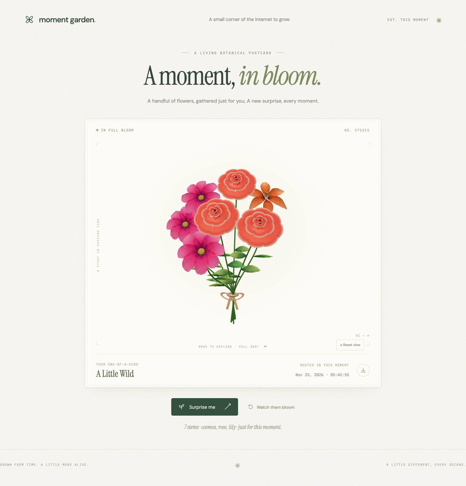
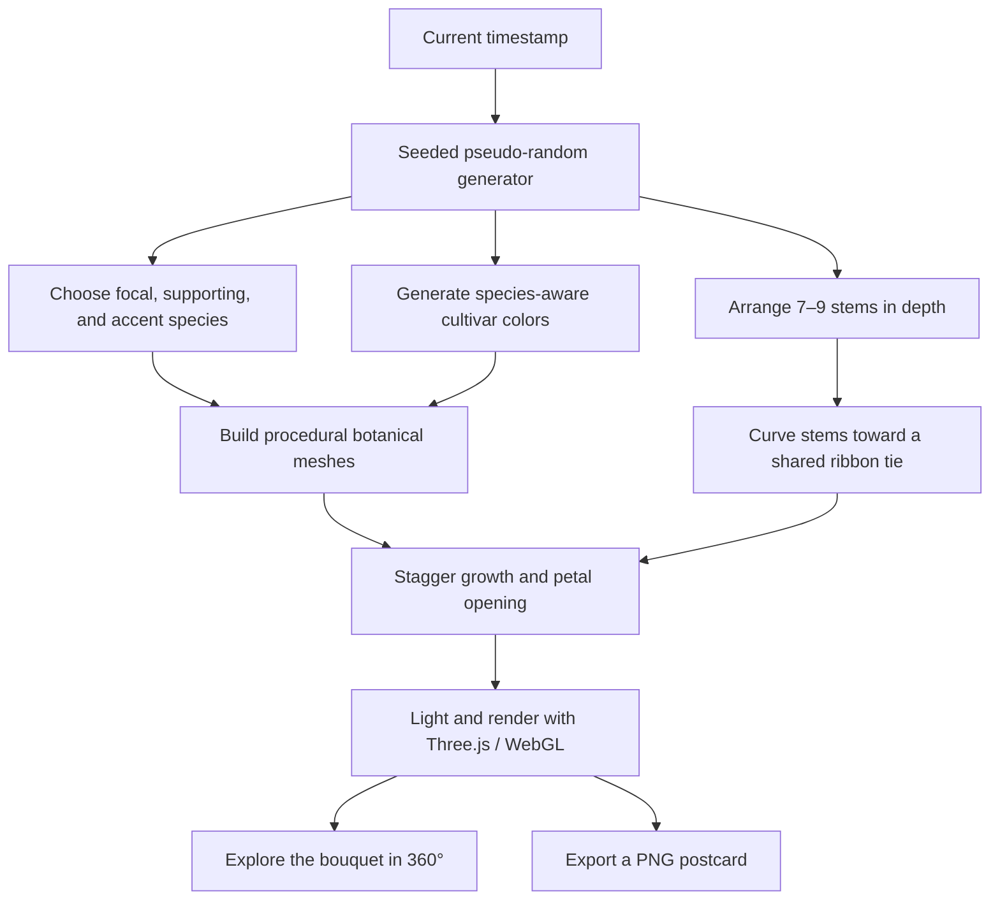

<p align="center">
  
</p>

<h1 align="center">Moment Garden</h1>

<p align="center"><em>A moment, in bloom.</em></p>

<p align="center">
  A tiny botanical postcard that grows a surprise 3D bouquet from the current timestamp.<br />
  No two arrivals quite alike. No settings to fuss with. Just flowers.
</p>

<p align="center">
  <a href="#the-garden">Preview</a> ·
  <a href="#run-it-locally">Run locally</a> ·
  <a href="#how-it-grows">How it works</a> ·
  <a href="#development">Development</a>
</p>

<p align="center">
  
  
  
  <a href="LICENSE"></a>
</p>

## The garden

Every visit gathers **7–9 stems from at least three flower types**, brings them into bloom, and ties them into a little bouquet. All geometry is generated in code—not loaded from photographs or model files.

<p align="center">
  
</p>

### Made to be explored

- **Always a surprise.** Timestamp-seeded species, proportions, arrangement, and cultivar colors; no color or species selectors.
- **Eight botanical recipes.** Roses, tulips, dahlias, sunflowers, daisies, lilies, poppies, and cosmos.
- **Different construction, not just recoloring.** Nested rose cups, six tulip shells, rolled dahlia florets, broad poppy petals, recurved lily tepals, and golden-angle disk centers.
- **A full blooming sequence.** Staggered growth, unfolding leaves, opening petals, and gentle swaying.
- **Unrestricted 360° rotation.** Explore above, below, and behind the bouquet with a mouse, touch, or keyboard.
- **A keepsake.** Download the current bouquet view as a PNG postcard.
- **A quieter experience.** Reduced-motion preferences show the completed bouquet without the growth animation or idle sway.

### One garden, many bouquets

These are actual browser renders of four timestamp-seeded arrangements—not concept art.

<p align="center">
  
</p>

### Desktop & mobile

<table>
  <tr>
    <td width="72%" valign="top"></td>
    <td width="28%" valign="top"></td>
  </tr>
</table>

## Run it locally

**No install, bundler, or build step is required.** Open [`index.html`](index.html) in a modern browser with WebGL enabled.

Or serve the directory over HTTP:

```sh
git clone https://github.com/mesterM12/moment-garden.git
cd moment-garden
python3 -m http.server 8000
```

Visit **http://localhost:8000**. Stop the server with `Ctrl+C`.

Three.js is vendored locally, so rendering does not depend on a JavaScript CDN. Google Fonts are optional network requests; system fonts are used if they are unavailable.

### Controls

| Action | Control |
| --- | --- |
| Rotate in any direction | Drag the bouquet with a mouse or one finger |
| Rotate with the keyboard | Focus the bouquet with `Tab`, then use the arrow keys |
| Return to the front | **Reset view**, or `Home` while the bouquet is focused |
| Generate a new bouquet | **Surprise me** |
| Replay the same bouquet | **Watch them bloom** |
| Save a PNG postcard | Download icon at the bottom-right of the card |

Touch gestures inside the bouquet rotate it; scroll the page from outside the illustration. Saving completes the bloom and captures the current viewing angle.

## How it grows



### A shared seed, independent details

`botany.js` turns a millisecond timestamp into a bouquet plan. Each stem gets a derived seed for its geometry, while repeated species share cultivar colors. Layout is chosen before tessellation, so changing mesh detail does not reshuffle the arrangement.

Replay keeps the existing bouquet; **Surprise me** starts from a new timestamp. Generation is deterministic for the same seed and generator version, though browser/GPU rendering can vary. There is no seed-entry UI or shareable-seed URL yet.

### Geometry with botanical cues

| Flower | Procedural construction |
| --- | --- |
| Rose | Nested angular-sector petals with overlapping lips and a closed center |
| Tulip | Two interleaved whorls of three curved shells forming an upright cup |
| Dahlia | 140 rolled florets arranged with golden-angle spacing over a rounded backing |
| Sunflower | Narrow ray petals surrounding a dark, densely sampled seed disk |
| Daisy | Slender ray petals surrounding a gold floret center |
| Poppy | Broad, ruffled petals around a capsule and dark stamens |
| Lily | Six recurved tepals, dark flecks, elongated anthers, and a central style |
| Cosmos | Eight broad rays with shallow tip notches and a golden center |

These are stylized procedural interpretations, not botanical simulations or photorealistic scanned models. Lighting, petal gradients, surface veins, and constrained pigment ranges help the species remain recognizable at postcard scale. Design observations and remaining refinement ideas are recorded in [`DESIGN-REVIEW.md`](DESIGN-REVIEW.md).

## Development

The site is plain HTML, CSS, and JavaScript. **Node.js 18+** is only needed to run the generator tests.

```sh
node --test botany.test.cjs
node --check botany.js
node --check flower.js
node --check petal-meshes.js
```

The automated tests cover deterministic generation, distinct species recipes, bouquet size and diversity, shared cultivar colors, valid geometry parameters, and species-aware pigment ranges. They do **not** prove botanical resemblance or catch visual clipping; those require browser inspection.

### Project map

```text
moment-garden/
├── index.html             # Postcard markup and controls
├── style.css              # Paper, typography, layout, responsive styles
├── botanical.css          # Illustration and interaction styles
├── botany.js              # Seeded species, pigments, and bouquet planning
├── petal-meshes.js        # Dedicated rose, tulip, and dahlia surfaces
├── flower.js              # Scene, other flower meshes, animation, input, export
├── botany.test.cjs        # Generator tests using Node's built-in test runner
├── DESIGN-REVIEW.md       # Botanical geometry review and refinement notes
├── docs/images/           # Logo, screenshots, gallery, and animated preview
└── vendor/                # Three.js 0.160.1 and its license
```

### Hosting

Deploy the folder to any static host. There is no backend, build command, database, API key, or runtime configuration. For GitHub Pages, select **Deploy from a branch → main → / (root)** in the repository's Pages settings.

### Contributing

Small botanical improvements are welcome. Keep the experience surprise-only, preserve seeded reproducibility, and check both desktop and mobile. When changing a mesh, include before/after renders and inspect it from the front, a quarter turn, and behind. Please run the generator tests before opening a pull request.

## Credits & license

- Rendering: [Three.js](https://threejs.org/), MIT; its license is retained in [`vendor/THREE-LICENSE.txt`](vendor/THREE-LICENSE.txt).
- Typography: Instrument Serif, DM Sans, and IBM Plex Mono, optionally loaded from Google Fonts.
- All bouquet geometry and screenshot examples are generated by this project.

Project code, documentation, logo, and screenshots are available under the [MIT License](LICENSE).

<p align="center"><em>Grown from time. A little different, every second.</em></p>
