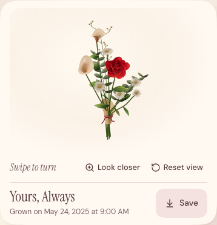
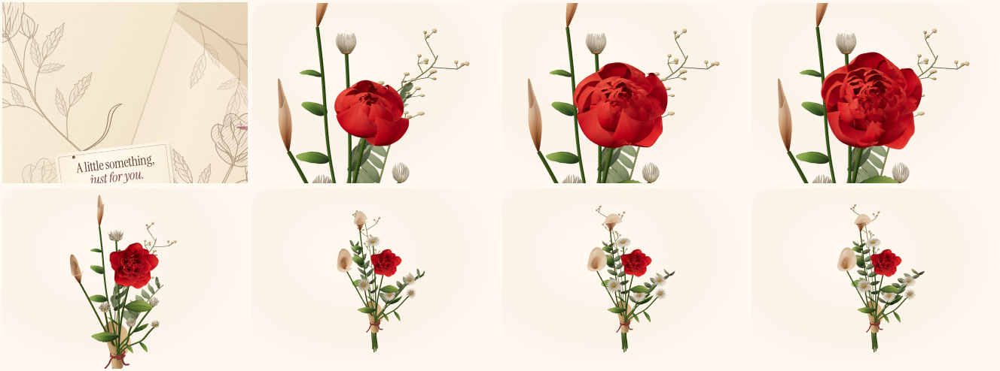
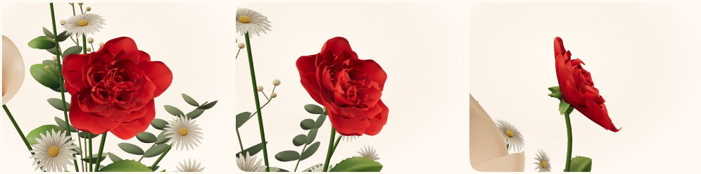
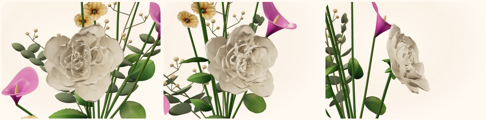

# Garden rose study

**Review gate:** This is the first rose candidate. Judge the form and close opening in the actual postcard before changing the lily or any other species. The framing and bloom clock apply to all bouquets; the new sculpt applies only to roses. Gift tokens, seeded colors, stem positions, and species are unchanged.

## Reproduce

- **Yours, Always**, Claret Rose: `/?bouquet=v3-1970260fd01` (`1748091600129`).
- **Sunday Morning**, Ivory Rose: `/?bouquet=v3-1970260fd08` (`1748091600136`). The pale petals make folded edges and occlusion easier to inspect.

Start the app locally, then run:

```sh
node tools/rose-proof.mjs http://127.0.0.1:3000/ /tmp/rose-study candidate
node tools/rose-proof.mjs http://127.0.0.1:3000/ /tmp/rose-ivory candidate v3-1970260fd08
```

The same script accepts `baseline` for a server running revision `6d72c13`. Playwright Chromium uses iPhone 13 emulation (390 × 844 CSS px); captures are written at CSS size. The real postcard is 358 × 372 CSS px and its artwork stage 326 × 241 in these captures. No specimen viewer, hidden stems, replacement background, or lens override is used in the proof. The mature macro is reachable by grabbing during the held shot and letting the petals finish. Angles are front, then five and ten right-arrow turns (about 43° and 86°) at that held framing. Neighboring flowers can pass out of the macro frame; the full bouquet is visible in the postcard and final opening frames.

## Finished postcard

| Before (`6d72c13`) | Candidate |
| --- | --- |
|  |  |

## Opening

Read left to right, top to bottom: **0.60, 0.90, 1.45, 1.80 / 3.30, 4.80, 5.75, 6.51s**. The lead guard leaves the bud first; the overlapping heart comes into view by the time the close hold ends. The lens then pulls out once with its direction fixed, and the bouquet finishes opening in its final framing. The plucked phrase ends at 6.10s. See the [full postcard at the held shot](images/rose-study/held-postcard.png). [Reduced-motion opening](images/rose-study/reduced-motion.png) goes directly to the full mature framing.



## Mature angles

[Baseline versus candidate at the standard Look closer framing](images/rose-study/detail-comparison.jpg) (baseline above, candidate below):





Look for a broad cup from the side, uneven overlapping lips and uneven pockets rather than one raised spiral from the front, and no green hole or isolated painted center. The deepest claret folds can merge into shadow at wide postcard size; the ivory check makes it easier to judge whether their forms read. The images verify composition and sequential poses, not perceptual smoothness under load. Physical phones, Safari audio output and perceived synchronization, and on-device frame rate were not verified.

## Shared camera

`src/garden/bloom-camera.ts` exports `BLOOM_FOV`, `BLOOM_FRONT_YAW`, and `createBloomFramer(camera)`. For a deterministic detached sampler, set the perspective camera's aspect/projection and bouquet presentation rotation, call `pose(bouquet, progress)`, then `framer.frameBloom(bouquet, progress)` before rendering. Progress is normalized to `BLOOM_DURATION` (6500 ms). `buildBouquet` supplies fixed bounding points for the whole arrangement and the swept focal head; seeking does not require rendering any previous frame. The still PNG and social capture use mature, whole-bouquet framing, independent of the live opening lens.
